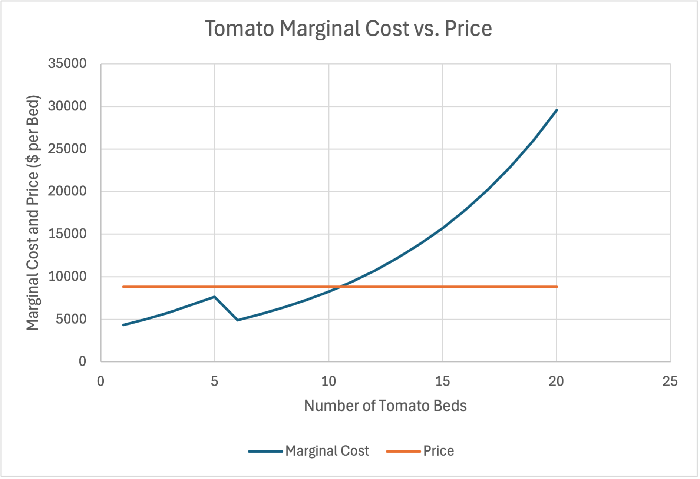
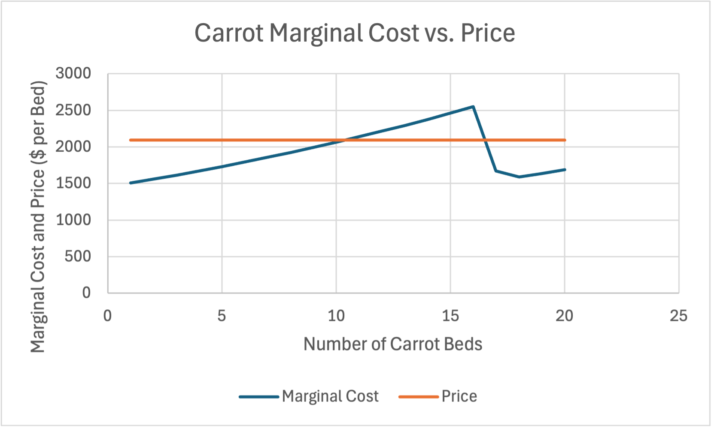

# Perfect Competition — Stage 3 Analysis

## Stage 2 Results
My Stage 2 model identified an optimal planting mix of 10 tomato beds, 20 carrot beds, and 30 mesclun beds. The calculated seasonal profit was $42,775.16.

My original hypothesis was 16 tomato beds, 20 carrot beds, and 28 mesclun beds. The model recommended fewer tomato beds because the additional labor and fertilizer costs reduced their profitability.

## Economic Analysis
The model shows that planting more than 10 tomato beds becomes less profitable because labor requirements continue to increase. Even though tomatoes generate $8,800 in revenue per bed, the additional labor and fertilizer costs reduce the benefit of planting more tomatoes. This demonstrates the importance of comparing marginal revenue with marginal cost when making production decisions.

## Figures
### Figure 1: Tomato Marginal Cost vs. Price

Figure 1 compares the marginal cost of planting additional tomato beds with the revenue of $8,800 per bed. The chart shows that marginal cost increases beyond the revenue level between beds 10 and 11.

### Figure 2: Carrot Marginal Cost vs. Price

Figure 2 compares the marginal cost of planting additional carrot beds with the revenue of $2,094 per bed. This helps illustrate how changes in production costs affect planting decisions.

## Limitations and Uncertainty
The model predicts a seasonal profit of $42,775.16, but actual profits could be different because of unexpected circumstances. For example, severe weather could damage or destroy crops, resulting in lost revenue and lower profits. Labor costs could also increase, making production more expensive. If workers become unavailable, the farm may struggle to maintain production. These uncertainties show that although the model provides a useful recommendation, actual profitability depends on real-world conditions.

## Recommendation
Based on the results of my economic model, I would recommend planting 10 tomato beds, 20 carrot beds, and 30 mesclun beds. This combination is projected to generate the highest seasonal profit of $42,775.16 under the model's assumptions. Although there are risks, such as unpredictable weather and increasing labor costs, taking calculated risks is part of running a business. I would follow the recommended planting mix because the model provides evidence that this combination is the most profitable option. However, I would continue monitoring costs and growing conditions and adjust the planting plan if circumstances change.

## Four Economic Questions

### Question 1: Where Does the Money Crop Stop, and Why There?
I would stop at the 10th bed because any planted beds after that number would be a reduction in profit. The 10th tomato bed costs approximately $8,248, while the 11th costs approximately $9,390. Each tomato bed generates $8,800 in revenue, but the 11th bed will reduce the profit by approximately $590. The decision is not just about revenue; production costs must also be considered.

### Question 2: Which Constraints Bind, and What Would Relaxing One Be Worth?
If I could change the planting limits for carrots and mesclun, I would consider planting more of each crop. Both crops have reached their maximum limits: 20 beds for carrots and 30 beds for mesclun. These are binding constraints. However, the farm uses only 60 of its 64 available beds, so the overall land constraint is slack. Increasing the crop limits could allow the farm to use the four empty beds and potentially increase profit. The 20th carrot bed has a marginal cost of approximately $1,688 compared with $2,094 in revenue, while the 30th mesclun bed has a marginal cost of approximately $2,420 compared with $2,700 in revenue. However, I would only plant additional beds if their marginal revenue exceeded their marginal cost. The current results suggest that increasing the planting limits could be beneficial, but the actual increase in profit would depend on the marginal costs of additional beds and any other production constraints. The model requires approximately 5,276.82 total labor hours, compared with 720 hours of the farm's own labor. This leaves approximately 4,556.82 hours to be covered by temporary labor. The farm uses its full own-labor allowance, but whether temporary worker availability is also binding would require checking the worker limit.

### Question 3: Does Any Marginal Cost Curve Ever Fall, and What Would Explain It?
The marginal cost decreases at certain points for tomatoes, carrots, and mesclun. For example, the marginal cost of tomatoes decreases from approximately $7,660 for the 5th bed to $4,906 for the 6th bed. One possible explanation is a change in labor costs. If the farm pays a lower hourly wage for the same amount of work, it spends less on labor. This does not necessarily mean the workers are more productive. It means the cost of producing an additional bed is lower. The decreases in the spreadsheet should be checked against the labor formulas to confirm the cause.

### Question 4: Would Each Crop Make Money on Its Own, and Does That Matter?
I would still consider planting tomatoes because they can contribute to the farm's profit. Rent is a fixed cost that must be paid whether the farm plants tomatoes, carrots, or mesclun. Labor and fertilizer are additional production costs that affect how much profit the farm makes. Even if growing one crop by itself does not cover all the fixed costs, it may still be worth planting as part of a combination of crops if its additional revenue is greater than its additional production costs. The farm should compare the profitability of each crop grown alone with the overall profit from growing a combination of crops. Using the model's labor costs and assigning the full $20,000 fixed cost to each crop separately, tomatoes would earn approximately $6,176.17 in profit at 10 beds. Carrots would lose approximately $16,480.20 at 20 beds, and mesclun would lose approximately $11,919.21 at 30 beds. However, the optimal combination of all three crops produces approximately $42,775.16 in seasonal profit. This shows that a crop does not necessarily need to cover all the farm's fixed costs by itself to contribute to a profitable planting mix.
